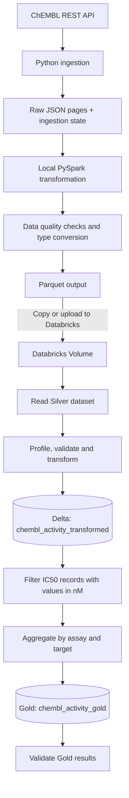

# ChEMBL Scientific Data Lakehouse

A Python data pipeline that retrieves bioactivity data from the ChEMBL REST API, validates and transforms it, and writes analytics-ready Parquet output with PySpark.

## Pipeline overview

```text
ChEMBL REST API
       |
       v
Paginated ingestion with retries
       |
       v
Raw JSON pages + ingestion state
       |
       v
Spark read, quality checks, and type conversion
       |
       v
Parquet output
```

The repository also includes a non-Spark JSON transformation module that writes selected fields to `data/silver`.

## Requirements

- Python 3.12 (the project uses modern Python type syntax)
- Java installed and available to PySpark through `JAVA_HOME` or `PATH`
- Python packages: `requests`, `pyspark`, and `pytest`

There is currently no dependency lockfile or `requirements.txt`; install the packages directly in your virtual environment.

## Setup

### Linux / macOS / WSL

```bash
python3 -m venv .venv
source .venv/bin/activate
python -m pip install requests pyspark pytest
```

### Windows PowerShell

```powershell
py -3.12 -m venv .venv
.\.venv\Scripts\Activate.ps1
python -m pip install requests pyspark pytest
```

## Run

From the repository root, start or resume API ingestion with:

```bash
python -m src.ingest_chembl
```

The equivalent project entry point is `python main.py`. Raw API pages are written under `data/raw`, with pagination state in `data/chembl_state.json`. Existing page files and state are used when resuming ingestion.

Run the Spark transformation and quality checks with:

```bash
python -m src.spark_transform
```

The Spark job reads JSON pages from `data/raw` and writes Parquet output to `~/chembl_spark_output` (the home directory of the current user). It also writes partitioned output as configured by the Spark module.

The separate JSON transformation can be run with:

```bash
python -m src.transform_activity
```

It writes selected activity fields under `data/silver` and creates `combined.json` there.

## Data fields

The transformations select these nine ChEMBL activity fields:

| Field | Description |
| --- | --- |
| `activity_id` | ChEMBL activity identifier |
| `molecule_chembl_id` | ChEMBL molecule identifier |
| `target_chembl_id` | ChEMBL target identifier |
| `assay_chembl_id` | ChEMBL assay identifier |
| `standard_type` | Standardized activity measurement type |
| `standard_value` | Standardized numerical activity value |
| `standard_units` | Units associated with the activity measurement |
| `pchembl_value` | Standardized potency value |
| `document_chembl_id` | ChEMBL document identifier |

The Spark transformation casts `standard_value` and `pchembl_value` to numeric types. Its quality checks cover required values, invalid numerical values, and duplicate activity identifiers.

## Tests

Run the unit test suite from the repository root:

```bash
python -m pytest -q
```

Tests are in `tests/unit` and cover API retry behavior, data quality checks, and Spark transformations.

## Project structure

```text
.
├── main.py
├── src/
│   ├── config.py
│   ├── ingest_chembl.py
│   ├── spark_data_skew.py
│   ├── spark_transform.py
│   ├── transform_activity.py
│   └── quality/
│       └── check_activity.py
├── tests/
│   └── unit/
│       ├── conftest.py
│       ├── test_ingest_retry.py
│       ├── test_quality.py
│       └── test_spark_transform.py
└── README.md
```

## Architecture



## Databricks analytics

The [chembl_databricks_pipeline.ipynb](chembl_databricks_pipeline.ipynb) notebook demonstrates a Databricks workflow for an existing Silver dataset. It reads Parquet data from a Databricks Volume, profiles and validates it, and writes it to Delta Lake. It then labels records by whether `standard_value` is present and saves the transformed data as `workspace.default.chembl_activity_transformed`.

For the Gold dataset, the notebook filters IC50 records with non-null `standard_value` reported in nM, then groups them by assay and target. It calculates distinct molecule counts and average standard values, writes the result to the Delta table `workspace.default.chembl_activity_gold`, and checks the saved data for duplicate assay–target pairs and invalid aggregate values.

Running the notebook requires a configured Databricks workspace, the source Parquet dataset at the Volume path configured in the notebook, and access to the `workspace.default` catalog and schema.

Generated data and Spark output are excluded from version control by `.gitignore`.